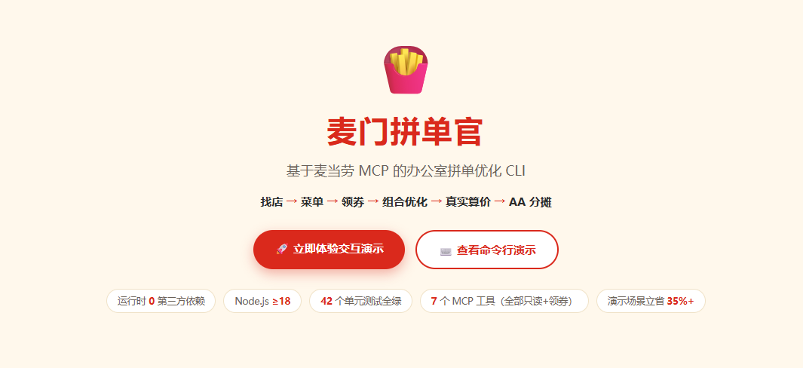
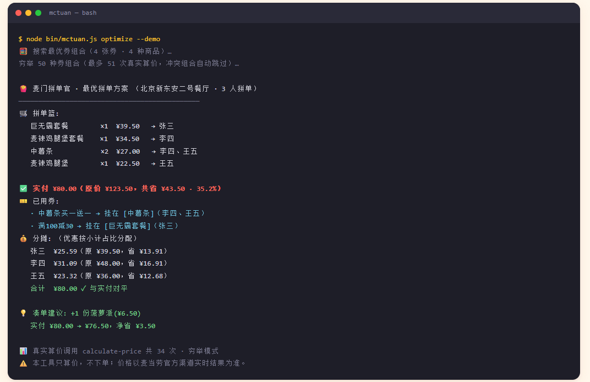
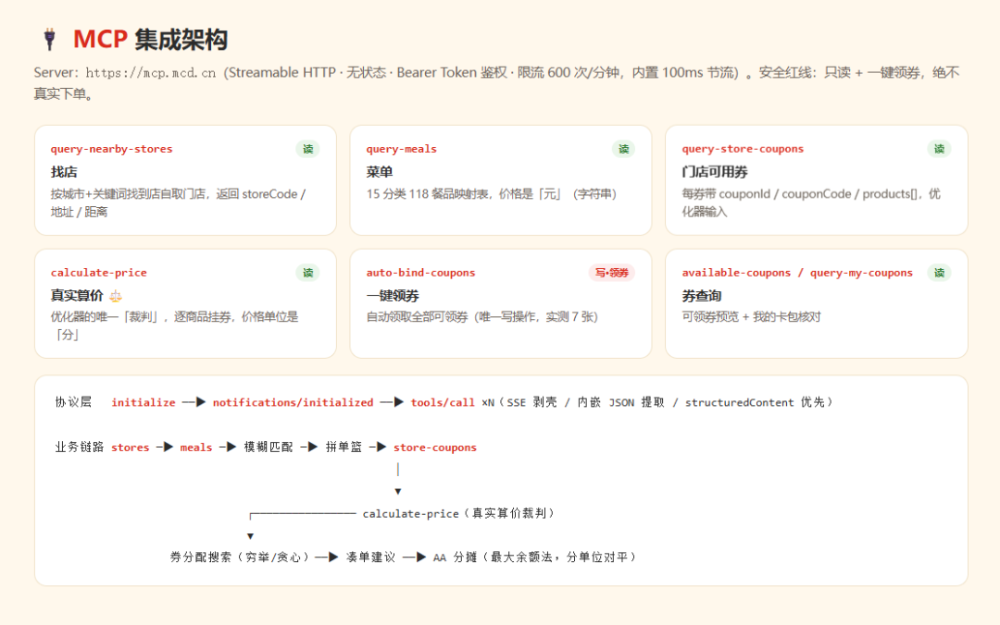

# 🍟 麦门拼单官 mcd-tuan-optimizer

> 基于麦当劳 MCP 的办公室拼单优化 CLI：找店 → 菜单 → 领券 → 组合优化 → 真实算价 → AA 分摊

  



## 痛点故事

办公室拼单点麦当劳是高频场景：下午三点，工位此起彼伏地冒出「我要个巨无霸」「给我带份薯条」「拼单吗？」——然后场面就失控了：

- **凑满减靠玄学**：满 100 减 30、满 130 减 40、中薯条买一送一……券和商品怎么组合最划算，谁也算不清；
- **券不知道挂给谁**：每张券要挂到具体商品上才生效，挂错商品优惠直接消失；
- **AA 算到友尽**：优惠算谁的？9 块 5 的可乐三个人怎么分？最后总是「差不多得了」。

**麦门拼单官**输入每个人的点餐意愿，自动完成全流程，输出最优拼单方案 + 每人应付金额：

```
🍟 麦门拼单官 · 最优拼单方案 （北京新东安二号餐厅 · 3 人拼单）
──────────────────────────────────────────────
🛒 拼单篮:
   巨无霸套餐        ×1  ¥39.50   → 张三
   麦辣鸡腿堡套餐    ×1  ¥34.50   → 李四
   中薯条            ×2  ¥27.00   → 李四、王五
   麦辣鸡腿堡        ×1  ¥22.50   → 王五

✅ 实付 ¥80.00（原价 ¥123.50，共省 ¥43.50 · 35.2%）
🎫 已用券:
   · 中薯条买一送一 → 挂在 [中薯条]（李四、王五）
   · 满100减30 → 挂在 [巨无霸套餐]（张三）
💰 分摊: （优惠按小计占比分配）
   张三  ¥25.59（原 ¥39.50，省 ¥13.91）
   李四  ¥31.09（原 ¥48.00，省 ¥16.91）
   王五  ¥23.32（原 ¥36.00，省 ¥12.68）
   ──────────────────────────────
   合计  ¥80.00 ✓ 与实付对平

💡 凑单建议: +1 份菠萝派(¥6.50)
   实付 ¥80.00 → ¥76.50，净省 ¥3.50
   加 --auto-add 可自动加入凑单品

📊 真实算价调用 calculate-price 共 34 次 · 穷举模式
⚠️ 本工具只算价，不下单；价格以麦当劳官方渠道实时结果为准。
```

（以上为 `node bin/mctuan.js optimize --demo` 的真实输出，无需 Token 即可复现）



## 目标用户

- **办公室同事**：拼下午茶/加班餐，发起人不想当「人肉计算器」；
- **宿舍/学生党**：预算敏感，每一分优惠都要榨干；
- **课题组/小团队**：人数多、口味杂，AA 要对得平、算得快。

## 安装

```bash
git clone https://github.com/ponnedor/mcd-tuan-optimizer.git
cd mcd-tuan-optimizer

# 零运行时依赖 —— npm install 不会安装任何第三方包（Node >= 18，内置 fetch 即可）
npm install   # 或直接跳过这一步

# 配置 Token（到 open.mcd.cn/mcp 申请）
export MCD_TOKEN=xxx          # Linux / macOS / Git Bash
# $env:MCD_TOKEN="xxx"        # Windows PowerShell

# 立即体验（无需 Token 的离线演示）
node bin/mctuan.js optimize --demo

# 可视化演示网站（双击即开，含交互式拼单优化 + 终端演示动画）
# demo-site/index.html

# 真实连线演示（演示服务器做 MCP 桥接，Token 不出服务端）
export MCD_TOKEN=xxx
node demo-site/server.js   # 打开 http://127.0.0.1:8080，切到「真实连线 MCP」
```

可选：全局安装命令 `npm link` 后可直接使用 `mctuan`。

## 命令用法

### 速查表

| 命令 | 用途 | 需要 Token |
| --- | --- | --- |
| `mctuan stores --city 北京 --keyword 王府井` | 查找附近门店（到店自取） | 是 |
| `mctuan menu --store 1950526 [--category 小食]` | 查看门店菜单（表格 + 价格） | 是 |
| `mctuan grab` | 一键领取所有可领的券（唯一写操作） | 是 |
| `mctuan coupons --store 1950526` | 查看该门店可用券 | 是 |
| `mctuan optimize --wishlist order.json [--auto-add]` | 拼单优化（主命令） | 是 |
| `mctuan optimize --demo [--auto-add]` | 内置演示数据，离线体验完整效果 | **否** |
| `mctuan --help` / `mctuan --version` | 帮助 / 版本 | 否 |

### 找店

```bash
node bin/mctuan.js stores --city 北京 --keyword 王府井
```

```
🍟 附近门店（北京 · 王府井）

  1. 北京新东安二号餐厅 [1950526]
     北京市东城区王府井大街138号新东安广场2层
     距离 0.8km

下一步: mctuan menu --store 1950526 查看菜单
```

### 看菜单（表格 + 价格，支持分类过滤）

```bash
node bin/mctuan.js menu --store 1950526
node bin/mctuan.js menu --store 1950526 --category 小食
```

```
📖 门店菜单（共 118 项）

分类        餐品                  现价      原价
─────────  ────────────────────  ───────  ───────
人气热卖    巨无霸套餐            ¥39.50   ¥45.00
人气热卖    龙焰芝士棒鸡腿堡三件套 ¥29.90   ¥51.50
鸡肉汉堡    麦辣鸡腿堡            ¥22.50   ¥25.00
小食拼盘    中薯条                ¥13.50   ¥14.50
...
```

### 一键领券（唯一允许的写操作）

```bash
node bin/mctuan.js grab
```

```
🎉 一键领券成功，共领取 7 张：

  1. 中薯条买一送一
  2. 王牌小食拼
  ...
```

### 看门店可用券

```bash
node bin/mctuan.js coupons --store 1950526
```

```
🎫 门店可用券（store 1950526 · 3 张）

  1. 中薯条买一送一
     适用: 中薯条
     couponId: C001 · couponCode: BOGO_FRIES · 2025-10-01 至 2025-12-31
  ...
```

### 拼单优化（主命令）

```bash
node bin/mctuan.js optimize --wishlist order.json          # 输出最优方案 + 凑单建议
node bin/mctuan.js optimize --wishlist order.json --auto-add  # 自动加入最优凑单品
node bin/mctuan.js optimize --demo [--auto-add]            # 内置演示数据，无需 Token
```

wishlist 格式（餐品名支持模糊匹配，匹配不到会给出候选列表，可参考 `order.example.json`）：

```json
{
  "storeCode": "1950526",
  "budget": 100,
  "people": [
    { "name": "张三", "wants": [{ "name": "巨无霸", "quantity": 1 }] },
    { "name": "李四", "wants": [{ "name": "麦辣鸡腿堡套餐", "quantity": 1 }, { "name": "薯条", "quantity": 1 }] }
  ]
}
```

字段说明：

| 字段 | 必填 | 说明 |
| --- | --- | --- |
| `storeCode` | 是 | 门店编码，来自 `mctuan stores` 的输出 |
| `storeName` | 否 | 门店名，仅用于输出展示 |
| `budget` | 否 | 预算（元），超出时输出提醒 |
| `people[].name` | 是 | 成员名，AA 分摊以此为准 |
| `people[].wants[].name` | 是 | 餐品名，支持模糊匹配（如「巨无霸」可命中「巨无霸套餐」） |
| `people[].wants[].quantity` | 否 | 数量，默认 1 |

退出码：`0` 成功；`1` 错误（如缺 Token、网络失败）；`2` 有餐品名未匹配到（会列出候选）；`3` 分摊未对平（理论不会发生，属兜底告警）。

`--auto-add` 效果（自动加入菠萝派，触发更高档满减）：

```
✅ 实付 ¥76.50（原价 ¥130.00，共省 ¥53.50 · 41.2%）
🎫 已用券:
   · 中薯条买一送一 → 挂在 [中薯条]（李四、王五）
   · 满130减40 → 挂在 [巨无霸套餐]（张三）
```

## 工作原理



```
┌────────────┐   ┌────────────┐   ┌────────────┐   ┌────────────────────┐   ┌────────────┐
│  wishlist  │──▶│ query-meals│──▶│ 名称模糊匹配 │──▶│   拼单篮 {code,qty} │──▶│ calculate- │
│ (每人想吃什么)│   │  (118餐品) │   │ (套餐↔三件套)│   │                    │   │   price    │
└────────────┘   └────────────┘   └────────────┘   └─────────┬──────────┘   └─────┬──────┘
                                                                             │ 基准价 base
                                    ┌────────────────────┐                   ▼
                                    │ query-store-coupons│            ┌───────────────┐
                                    │  (每券适用商品集)   │──────────▶ │  券分配搜索    │
                                    └────────────────────┘            │ 穷举/贪心+局部│
                                                                      └───────┬───────┘
                          ┌──────────────────┐        每个组合都真实调价      │ 最优方案
                          │  AA 分摊          │◀─── calculate-price 裁决 ────┘
                          │ (最大余额法对平)  │
                          └──────────────────┘
```

三条核心设计：

1. **真实价格是唯一裁判**：优化器自己从不计算优惠，每个候选组合都调用 `calculate-price`（支持逐商品挂 `couponId/couponCode`）验真实价，保证输出与真实结算一致；
2. **组合搜索**：商品 ≤15、券 ≤8 且组合数在预算内时穷举笛卡尔积；超出时贪心剪枝（优先预期折扣大的券）+ 局部验证。全程受 600 次/分钟限流约束（100ms 节流 + 调用预算）；
3. **AA 严格对平**：优惠按各人小计占比分配（最大余额法整数分配），分摊之和与订单实付严格相等，尾差（≤2 分）归发起人 —— 该正确性约束有专门的单元测试（含 200 组随机压力测试）。

货币全程以「分」（整数）运算，仅在展示层转元，杜绝浮点误差。MCP 协议细节（端点、工具清单、单位换算坑、响应解析规则）见 [`MCP_INTEGRATION.md`](./MCP_INTEGRATION.md)。

## 可视化演示网站

`demo-site/index.html` 是给评委/路人准备的演示页（单文件零依赖，双击即开），包含两种模式：

| 模式 | 数据来源 | 使用方式 |
| --- | --- | --- |
| 🧪 离线演示 | 内置演示数据（逻辑与 CLI 完全一致，数值已用单元级对拍验证） | 直接双击打开 `demo-site/index.html` |
| 🔴 真实连线 | **真实麦当劳 MCP**（经 `demo-site/server.js` 桥接，SSE 逐组合回推进度） | `export MCD_TOKEN=xxx && node demo-site/server.js` 后访问 `http://127.0.0.1:8080` |

安全设计：桥接服务器零依赖（Node 内置 `http`），`MCD_TOKEN` 只存在于服务端环境变量，**绝不进入浏览器或前端代码**；浏览器与服务器同源（127.0.0.1），无跨域问题。网页与 CLI 复用同一套 `src/core` 优化/分摊代码。

### 真实连线模式操作步骤

1. `export MCD_TOKEN=xxx`（Windows PowerShell 用 `$env:MCD_TOKEN="xxx"`）；
2. `node demo-site/server.js` 启动桥接服务器；
3. 浏览器访问 `http://127.0.0.1:8080`，顶部切换到「🔴 真实连线 MCP」；
4. 输入门店编码（如 `1950526`，可先用 `mctuan stores` 查到）→ 点「拉取真实菜单」；
5. 左侧编辑每个拼单人想吃的餐品与数量 → 点「真实优化（连麦当劳 MCP）」；
6. 右侧流水线实时推进：建篮算基准价 → 穷举券组合 → 最优方案 + AA 分摊 → 凑单建议，全程经 `calculate-price` 真实裁决。

## 真实跑一次长什么样

以下为 2026-10-16 在北京新东安二号餐厅（`storeCode=1950526`）的真实运行记录（Token 已脱敏）：

```bash
$ node bin/mctuan.js stores --city 北京 --keyword 王府井
🍟 附近门店（北京 · 王府井）
  1. 北京新东安二号餐厅 [1950526]
     北京市东城区王府井大街138号新东安广场2层 · 距离 0.8km

$ node bin/mctuan.js menu --store 1950526
📖 门店菜单（共 118 项）
  人气热卖  巨无霸套餐            ¥39.50   ¥45.00
  人气热卖  龙焰芝士棒鸡腿堡三件套  ¥29.90   ¥51.50
  ...

$ node bin/mctuan.js coupons --store 1950526
🎫 门店可用券（store 1950526 · 3 张）
  1. 中薯条买一送一   2. 王牌小食拼   3. 9.9 元冰美式

$ node bin/mctuan.js optimize --wishlist order.example.json
🍟 麦门拼单官 · 最优拼单方案（北京新东安二号餐厅 · 3 人拼单）
  ...
✅ 实付 ¥XX.XX（原价 ¥XXX.XX，共省 ¥XX.XX）
📊 真实算价调用 calculate-price 共 N 次 · 穷举模式
```

整条链路 `stores → menu → coupons → optimize` 全部真实命中麦当劳 MCP，无本地 mock。

## 测试

```bash
npm test     # node:test，42 个用例全绿
```

覆盖四类核心正确性：① AA 分摊对平（含随机压力测试）② MCP 响应 JSON 提取（SSE 剥壳 / 说明文字+内嵌 JSON / structuredContent 优先）③ 券分配穷举最优性（含暴力对拍）④ 菜单名称模糊匹配。

测试文件与对应职责：`test/splitter.test.js`（分摊对平）、`test/extract.test.js`（JSON 提取）、`test/optimizer.test.js`（穷举最优性）、`test/match.test.js`（模糊匹配），真实响应样例存于 `fixtures/`。

## 常见问题（FAQ）

**Q: 没有 Token 能体验吗？**
可以。`node bin/mctuan.js optimize --demo` 使用内置演示数据 + 模拟算价，离线跑通完整流程；或直接双击打开 `demo-site/index.html` 的可视化演示。

**Q: Token 在哪里申请？**
到 [open.mcd.cn/mcp](https://open.mcd.cn/mcp) 申请，通过环境变量 `MCD_TOKEN` 注入。仓库内不含任何真实凭证。

**Q: 会帮我下单吗？**
不会。安全红线：只调用只读工具 + `auto-bind-coupons`（一键领券），**绝不**触发任何真实订单。详见 `MCP_INTEGRATION.md` 的工具调用面收敛。

**Q: 报「未检测到 MCD_TOKEN 环境变量」？**
先设置环境变量：`export MCD_TOKEN=xxx`（Linux/macOS/Git Bash）或 `$env:MCD_TOKEN="xxx"`（Windows PowerShell）。仅 `--demo` 与 `--help/--version` 不需要。

**Q: 餐品名匹配不到怎么办？**
报错会列出最接近的候选名称；也可以先跑 `mctuan menu --store <code>` 查准确实名。匹配支持「套餐↔三件套」等价、包含、归一化等规则。

**Q: 为什么输出里要显示算价调用次数？**
每 Token 每分钟限流 600 次。工具内置 100ms 节流 + 调用预算（优化 300 / 凑单 20 / auto-add 380），并在结尾回显实际调用次数，便于评估余量。

## 工程结构

```
mcd-tuan-optimizer/
├── README.md                  # 本文件
├── CONTEST_DECLARATION.md     # 官方参赛声明（原样复制）
├── MCP_INTEGRATION.md         # MCP 接入说明（工具清单/流程图/业务价值）
├── mcp-config.example.json    # MCP 接入示例（Token 仅占位符）
├── order.example.json         # wishlist 示例
├── package.json               # bin 入口 + test 脚本，零运行时依赖
├── bin/mctuan.js              # CLI 入口
├── demo-site/
│   ├── index.html             # 可视化演示网站（单文件零依赖，离线/真实连线双模式）
│   └── server.js              # 演示桥接服务器（零依赖，Token 不出服务端，SSE 回推进度）
├── src/
│   ├── mcp/client.js          # MCP 客户端（SSE 剥壳、JSON 提取、节流、错误处理）
│   ├── mcp/tools.js           # 6 组工具的语义化封装（收敛安全红线）
│   ├── core/optimizer.js      # 券分配搜索 + 凑单建议（纯函数）
│   ├── core/splitter.js       # AA 分摊（纯函数）
│   ├── core/match.js          # 菜单名称模糊匹配（纯函数）
│   ├── ui/render.js           # 彩色输出/表格（手写 ANSI）
│   └── demo/index.js          # 离线演示数据 + 模拟算价 oracle
├── fixtures/                  # 实测响应样例（SSE/混排文本），供测试用
├── test/                      # node:test 单测
└── docs/screenshots/          # README 截图（演示网站 / MCP 架构 / CLI 运行效果）
```

## 免责声明

- 本工具是麦当劳程序员节创意开发大赛的参赛作品，非麦当劳官方产品；
- **只算价，不下单**：代码只调用只读工具 + 一键领券（`auto-bind-coupons`），绝不触发任何真实订单；
- 输出仅供参考，餐品信息、价格及供应状态以麦当劳官方渠道的实时结果为准；
- Token 通过 `MCD_TOKEN` 环境变量注入，仓库内不含任何真实凭证。

## 许可

MIT
